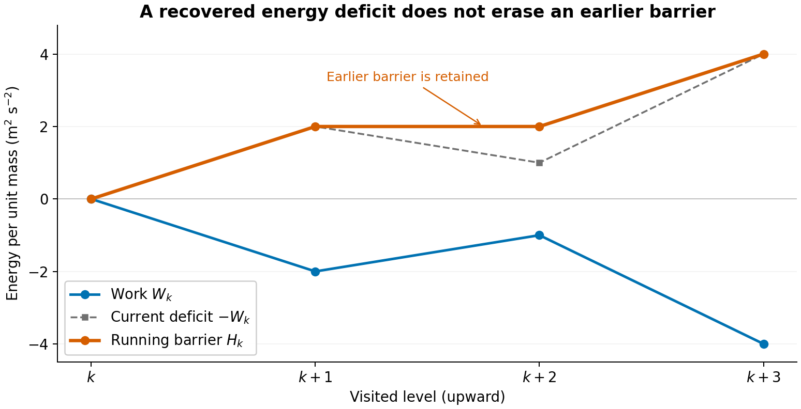
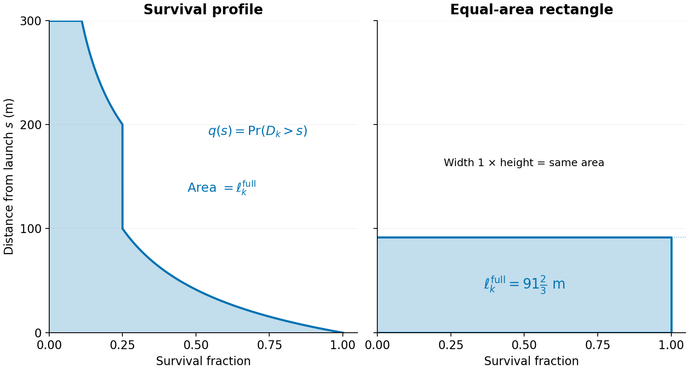

# A survival-weighted parcel calculation of CLUBB's turbulent mixing length

This note explains how CLUBB estimates a turbulent mixing distance by following air parcels,
and how the coherent method uses a survival fraction to soften the decision to stop a
parcel. It describes the legacy method and
[`compute_coherent_mixing_length`](../src/CLUBB_core/mixing_length.F90), including the
currently selected `coherence_average_overwrite` aggregation. The
[JAX port](../clubb_jax/src/CLUBB_core/mixing_length.py) implements the same physical rules
with fixed-length scans and masks.

**Updated:** 21 October 2026

## 1. Purpose of the turbulent mixing length

An atmospheric model divides a column of air into vertical levels. Air motions smaller than
these resolved levels still transport heat, water, and momentum. CLUBB represents their
collective effects using statistical quantities, including turbulent kinetic energy: the
energy associated with fluctuating air motion, per unit mass of air.

The model needs a characteristic distance over which these motions exchange air with their
surroundings. This distance is the **mixing length**, denoted by $L$ and measured in meters.
It helps determine both how quickly turbulence loses energy and how strongly turbulence
mixes the surrounding air.

For example, the length-based estimate of the turbulence time scale is

$$
\tau=\min\left(\frac{L}{\sqrt{e}},\tau_{\max}\right).
$$

Here $e>0$ is turbulent kinetic energy per unit mass, $\sqrt{e}$ is a velocity scale,
$\tau$ is a time scale in seconds, and $\tau_{\max}$ is its prescribed upper bound.
The operation $\min$ selects the smaller value. The code protects the velocity scale with
a positive energy floor. The corresponding basic turbulent-diffusion scaling is

$$
K_h=c_K L\sqrt{e},
$$

where $K_h$ is a transport coefficient, called an eddy diffusivity, in square meters per
second, and $c_K$ is a dimensionless model coefficient. These expressions illustrate the
role of the mixing length; other parts of CLUBB apply additional corrections and bounds.
A larger $L$ generally gives a longer turbulence time scale and stronger mixing. Consequently,
abrupt changes in $L$ can feed back into the evolving model state.

The parcel calculation estimates this length by following an idealized small sample of air,
called a **parcel**, through its environment. As it moves, the parcel mixes with surrounding
air and changes temperature and water content. These changes determine its buoyancy: the
acceleration caused by its density differing from that of its surroundings.

The legacy calculation asks how far a parcel with one prescribed launch energy can
travel before adverse buoyancy exhausts that energy. The coherent calculation replaces
this sharp stopping decision with a gradual statistical weight. Its main purpose is to
reduce abrupt changes in the diagnosed length while keeping the calculation inexpensive.
Variability in launch energy provides the physical motivation for this smoothing; the
particular energy distribution is chosen principally for computational convenience.

Two different averages appear below. First, an **assumed distribution of launch energies**
provides a weight for each trajectory. No energy samples or separate ensemble of parcels
are generated at a launch level. Second, the algorithm **combines trajectories computed
from different launch levels** when assigning the final length at a level. Section 5
explains both operations and how they fit together.

## 2. Parcel-displacement interpretation and notation

### 2.1 Launch level, visited level, and direction

Consider one column at one instant. We omit column and time labels throughout: environmental
profiles and model parameters are held fixed during this calculation. Parameters can differ
between columns, but are constant with height unless explicitly shown otherwise.

Number the temperature-and-water levels upward, from $1$ to $N$, where $N$ is the number of
these levels. Let $z_j$ be the height of level $j$, with $z_{j+1}>z_j$. The highest level,
$N$, supplies an upper boundary; the final mixing length is calculated on active levels
$1,\ldots,N-1$ and copied from level $N-1$ to level $N$. This mathematical numbering does
not depend on whether the implementation stores the grid upward or downward.

Use **$k$ for the launch level** and **$j$ for the visited level**. The contributing launches
have $1\leq k\leq N-1$. The label $k$ stays fixed while following a particular trajectory.
The argument $j$ changes as that trajectory moves. Unless a direction is explicitly
indicated, equations describe upward travel, so $j\geq k$.

| Symbol | Meaning | Units |
|---|---|---|
| $z_j$ | Height of visited level $j$ | m |
| $\Delta z_j=z_j-z_{j-1}$ | Thickness of the upward layer ending at $j$ | m |
| $e(k)$ | Local turbulent kinetic energy, interpolated to launch level $k$ | $\mathrm{m^2\,s^{-2}}$ |
| $K_{0,k}$ | Nonnegative local energy used as the reference launch energy | $\mathrm{m^2\,s^{-2}}$ |
| $E_k$ | Mean energy of the assumed launch-energy distribution; fixed for this launch | $\mathrm{m^2\,s^{-2}}$ |
| $b_k(j)$ | Buoyant acceleration along the direction of travel | $\mathrm{m\,s^{-2}}$ |
| $W_k(j)$ | Accumulated buoyancy work from launch through level $j$ | $\mathrm{m^2\,s^{-2}}$ |
| $H_k(j)$ | Greatest energy deficit encountered through level $j$ | $\mathrm{m^2\,s^{-2}}$ |
| $0<q_k(j)\leq1$ | Survival fraction at level $j$ | dimensionless |

For example, $q_3(6)$ describes the weight at level 6 of the trajectory launched at level 3.
Each launch has its own functions $W_k$, $H_k$, and $q_k$; the energy scale $E_k$ is a
constant used to define those functions. All energies and work in this report are **per
unit mass**. The units $\mathrm{m^2\,s^{-2}}$ are equivalent to joules per kilogram.

Environmental quantities have no launch label. For example, $\bar\theta_l(j)$ is the
surrounding air's mean liquid-water potential temperature at level $j$, whereas
$\theta_{l,k}(j)$ is that property in the parcel launched at $k$. A bar on an environmental
quantity denotes the local model mean. Section 5 separately defines $\bar q_k(j)$ as an
average across a layer.

### 2.2 Energy and the legacy stopping rule

The reference launch energy is

$$
K_{0,k}=e(k),
$$

where $e(k)>0$ is local turbulent kinetic energy. CLUBB
[calculates this energy](../src/CLUBB_core/advance_clubb_core_module.F90) as half the sum
of the zonal, meridional, and vertical velocity variances (`up2`, `vp2`, and `wp2`), then
interpolates it to the launch level. The legacy method assigns this single launch energy
to the parcel. Buoyancy then adds or removes energy as the parcel moves.

To describe a position between levels, let $s\geq0$ be distance traveled from launch.
For upward motion, the distance to level $j$ is $s_k(j)=z_j-z_k$. Let $b_k(s)$
(units $\mathrm{m\,s^{-2}}$) be buoyant acceleration along this continuous path. At a
grid level, we write $b_k(j)$ as shorthand for $b_k(s_k(j))$. Define cumulative work
$\mathcal W_k(s)$ and remaining energy $\mathcal K_k(s)$ by

$$
\mathcal W_k(s)=\int_0^s b_k(u)\,du,
\qquad
\mathcal K_k(s)=K_{0,k}+\mathcal W_k(s).
$$

The integral adds acceleration times a small travel distance along the path; $u$ is the
distance variable being integrated. Positive work adds energy, and negative work removes it.
Calligraphic letters here denote continuous-path quantities; $W_k(j)$ below denotes the
value computed by the discrete layer updates.

The parcel stops at the **first** point where its remaining energy is nonpositive, or at
the path boundary if it never exhausts its energy. This first stopping point is often called
a *first passage*. A favorable region beyond an uncrossable barrier cannot help the parcel:
it must first have enough energy to reach that region.

The buoyant-parcel approach is the background for the legacy formulation described by
[Golaz et al. (2002)](https://doi.org/10.1175/1520-0469(2002)059%3C3540:APBMFB%3E2.0.CO;2),
with moist thermodynamic relationships related to
[Bougeault (1981)](https://doi.org/10.1175/1520-0469(1981)038%3C2414:MTTWCB%3E2.0.CO;2).

## 3. Thermodynamic and energetic calculation

This section explains how a trajectory supplies the buoyancy work and energy barrier.
Section 5 explains how the new method converts that barrier into a distance. The essential
sequence is: set the launch properties, mix surrounding air into the moving parcel,
calculate its buoyancy, and accumulate the work done by that buoyancy.

### 3.1 Parcel properties and the launch state

The parcel carries two temperature-and-water variables:

- $\theta_{l,k}(j)$ is its **liquid-water potential temperature**, in kelvin. This temperature
  variable accounts approximately for pressure changes and the heat associated with cloud
  liquid water, making it useful for following moving air.
- $r_{t,k}(j)$ is its **total-water mixing ratio**, the mass of water vapor plus cloud liquid
  water per unit mass of dry air, in kilograms per kilogram.

Their environmental means are $\bar\theta_l(j)$ and $\bar r_t(j)$. These variables are
approximately conserved by the idealized moist parcel when it moves without mixing with
its environment. Their changes along a trajectory can therefore be calculated from the
assumed mixing, called **entrainment**.

The legacy calculation launches from the environmental means. The new calculation permits
a departure from those means using CLUBB's existing subgrid probability density function
(PDF), which describes statistical variability of air properties within a model level.
Its components 1 and 2 supply the upward and downward launch properties, respectively.
Let $\theta_{l,1}(k)$ and $r_{t,1}(k)$ be the component-1 mean properties at launch. For
upward travel,

$$
\theta_{l,k}(k)=\bar\theta_l(k)
 +f_{\mathrm{PDF}}\bigl[\theta_{l,1}(k)-\bar\theta_l(k)\bigr],
$$

$$
r_{t,k}(k)=\bar r_t(k)
 +f_{\mathrm{PDF}}\bigl[r_{t,1}(k)-\bar r_t(k)\bigr].
$$

The dimensionless fraction $f_{\mathrm{PDF}}\in[0,1]$ is `Lscale_pdf_launch_frac`.
Zero gives an environmental-mean launch; one gives a component-mean launch. The downward
calculation uses the corresponding component-2 means, $\theta_{l,2}(k)$ and $r_{t,2}(k)$.
The default parameter value is zero. This existing temperature-and-water PDF is distinct
from the additional assumed **energy** distribution introduced in Section 5.

### 3.2 Entrainment through one layer

Write $\chi_k$ for either parcel property $\theta_{l,k}$ or $r_{t,k}$, and $\bar\chi$ for
its environmental mean. Along the path, the entrainment model is

$$
\frac{d\chi_k}{ds}=-\mu(\chi_k-\bar\chi).
$$

The derivative on the left is the change in the parcel property per unit travel distance.
The positive rate $\mu$, in inverse meters, is `Lscale_mu_entrain`. The equation moves the
parcel property toward its surroundings: a parcel value above the environmental value
decreases, and a value below it increases. Here $\chi_k$ and $\bar\chi$ are evaluated at
the same position along the path; their values at levels are written as $\chi_k(j)$ and
$\bar\chi(j)$.

Assume $\mu$ is constant and the environmental property varies linearly across each layer.
For the upward layer from $j-1$ to $j$, define two dimensionless coefficients,

$$
R(j)=\exp(-\mu\Delta z_j),
\qquad
A(j)=\frac{1-R(j)}{\mu\Delta z_j}.
$$

The function $\exp$ is the exponential function. The factor $R(j)$ retains the dependence
on the incoming parcel property, while $A(j)$ accounts for the environmental gradient
within the layer. Define an environmental contribution $C_\chi(j)$, with the same units
as $\chi$, by

$$
C_\chi(j)=\bar\chi(j)-R(j)\bar\chi(j-1)
 -A(j)\bigl[\bar\chi(j)-\bar\chi(j-1)\bigr].
$$

The parcel update is then

$$
\chi_k(j)=R(j)\chi_k(j-1)+C_\chi(j).
$$

This is the exact solution of the entrainment equation under the stated assumptions.
It is an *affine* update: multiply the incoming value by a factor, then add a contribution.
The coefficients depend on the layer and direction but not on the launch level, so they can
be calculated once and reused for every parcel that crosses that layer.

The retention factor $R(j)$ describes mixing of parcel properties. It is not the survival
fraction $q_k(j)$, which instead describes the statistical effect of an energy barrier.
The implemented entrainment formula requires $\mu>0$ and nonzero layer thickness.

### 3.3 From temperature and water to buoyancy

Temperature and water affect density, and density differences cause buoyancy. The calculation
first estimates how much of the parcel water is liquid, then uses a temperature variable
that expresses the combined effects of temperature, water vapor, and liquid water on density.

The environmental inputs and physical constants used here are:

| Symbol | Meaning | Units |
|---|---|---|
| $p(j)$ | Environmental air pressure at level $j$ | Pa |
| $\Pi(j)$ | Exner factor, the dimensionless pressure factor used to convert potential-temperature variables to temperature variables | dimensionless |
| $\bar\theta_v(j)$ | Environmental mean virtual potential temperature, a temperature measure incorporating water's effects on density | K |
| $\theta_{v,\mathrm{ref}}(j)$ | Prescribed dry reference-state virtual potential temperature, called `thv_ds` in the code | K |
| $g$ | Magnitude of gravitational acceleration | $\mathrm{m\,s^{-2}}$ |
| $L_v$ | Latent heat of vaporization: energy needed to evaporate a unit mass of water | $\mathrm{J\,kg^{-1}}$ |
| $R_d$, $R_v$ | Gas constants for dry air and water vapor | $\mathrm{J\,kg^{-1}\,K^{-1}}$ |
| $C_p$ | Specific heat of dry air at constant pressure | $\mathrm{J\,kg^{-1}\,K^{-1}}$ |

The Exner factor is

$$
\Pi(j)=\left[\frac{p(j)}{p_{\mathrm{ref}}}\right]^{R_d/C_p},
$$

where $p_{\mathrm{ref}}=100000\ \mathrm{Pa}$ is the reference pressure, called `p0` in
the code. This factor expresses the pressure dependence of the temperature conversion.

Define the parcel's liquid-water temperature variable $T_{l,k}(j)$ and its saturation
mixing ratio $r_{s,k}(j)$ by

$$
T_{l,k}(j)=\Pi(j)\theta_{l,k}(j),
\qquad
r_{s,k}(j)=r_{\mathrm{sat}}\bigl(p(j),T_{l,k}(j)\bigr).
$$

Here $r_{\mathrm{sat}}(p,T)$ is the saturation mixing ratio over liquid water at pressure
$p$ and temperature $T$: the amount of water vapor per unit dry-air mass at saturation.
The legacy method uses the configured saturation formula. The coherent
method always uses the local `sat_mixrat_liq_flatau` polynomial, independently of
the configured saturation formula. That helper evaluates temperature no lower than
$-85\,{}^\circ\mathrm C$ and returns $R_d/R_v$ when pressure minus saturation vapor
pressure is less than $1\ \mathrm{Pa}$, matching its pressure-limit convention.
$T_{l,k}$ is in kelvin and
$r_{s,k}$ is in kilograms per kilogram. $T_{l,k}$ is an intermediate temperature variable;
condensation heating is accounted for in the subsequent buoyancy calculation.

Let $\epsilon=R_d/R_v$ be a dimensionless ratio of gas constants. The estimated cloud-liquid
mixing ratio, $r_{c,k}(j)$, is

$$
r_{c,k}(j)=\max\left[
\frac{\bigl[r_{t,k}(j)-r_{s,k}(j)\bigr]T_{l,k}(j)^2}
 {T_{l,k}(j)^2+\dfrac{\epsilon L_v^2}{R_d C_p}r_{s,k}(j)},
0\right].
$$

This approximation converts excess total water into liquid water while accounting for
condensation heating. The maximum with zero prevents negative liquid water. It is related
to the saturation adjustment of
[Lewellen and Yoh (1993)](https://doi.org/10.1175/1520-0469(1993)050%3C1228:BMOEPC%3E2.0.CO;2).

Define two more dimensionless constants, $\epsilon_1=(1-\epsilon)/\epsilon$ and
$\epsilon_2=1/\epsilon$. The parcel virtual potential temperature, $\theta_{v,k}(j)$ in
kelvin, is approximated by

$$
\theta_{v,k}(j)=\theta_{l,k}(j)
 +\epsilon_1\theta_{v,\mathrm{ref}}(j)r_{t,k}(j)
 +\left[\frac{L_v}{\Pi(j)C_p}
        -\epsilon_2\theta_{v,\mathrm{ref}}(j)\right]r_{c,k}(j).
$$

The water terms represent the effects of water vapor, condensation heating, and liquid-water
loading. The physical buoyancy acceleration $B_k(j)$, positive upward, is

$$
B_k(j)=g\frac{\theta_{v,k}(j)-\bar\theta_v(j)}{\bar\theta_v(j)}.
$$

A positive value accelerates the parcel upward. For upward travel the path-oriented buoyancy
is $b_k(j)=B_k(j)$. This calculation is also applied at launch in the coherent method,
so $b_k(k)$ need not be zero. The legacy method sets the launch buoyancy to zero.

### 3.4 Accumulated work and the running energy barrier

At launch, no distance has been traveled and no work has been accumulated:

$$
W_k(k)=0,
\qquad H_k(k)=0.
$$

For each subsequent upward layer, the trapezoidal work update is

$$
W_k(j)=W_k(j-1)
 +\frac{b_k(j-1)+b_k(j)}{2}\Delta z_j.
$$

This is previous work plus average endpoint acceleration times layer thickness. It is exact
for the work integral if acceleration varies linearly inside that layer. Favorable buoyancy
increases $W_k$; opposing buoyancy decreases it.

The current work is insufficient to determine whether the parcel could have reached this
level. We must also remember earlier deficits. Define the running energy barrier by

$$
H_k(j)=\max\bigl(H_k(j-1),-W_k(j)\bigr).
$$

Equivalently,

$$
H_k(j)=\max\left(0,\max_{k\leq m\leq j}[-W_k(m)]\right),
$$

where $m$ runs over every level visited from $k$ through $j$. Thus $H_k(j)$ is the greatest
energy deficit seen so far. It is nonnegative: zero if there has been no deficit, and
positive when energy is needed to cross an adverse region. Although it opposes ascent,
the barrier is expressed as a positive energy requirement. It is monotonically
nondecreasing along the path; favorable work cannot lower an earlier barrier.
For a candidate launch energy $x>0$, reaching all these endpoints
without exhausting energy requires $x>H_k(j)$.

For example, the following hypothetical work values all have units of $\mathrm{m^2\,s^{-2}}$:

| Visited level | Work $W_k(j)$ | Barrier $H_k(j)$ |
|---|---:|---:|
| $k$ | 0 | 0 |
| $k+1$ | -2 | 2 |
| $k+2$ | -1 | 2 |
| $k+3$ | -4 | 4 |

The favorable work between $k+1$ and $k+2$ partly restores energy, but it does not remove
the earlier requirement to overcome a deficit of 2.

The dots show the endpoint values in the table; connecting lines are guides. The barrier
$H_k$ retains the largest nonnegative deficit $-W_k$ encountered so far, even when the
current deficit decreases.

For comparison, the continuous-path barrier would be

$$
\mathcal H_k(s)=\max\left(0,\max_{0\leq u\leq s}[-\mathcal W_k(u)]\right),
$$

where $\mathcal W_k$ was defined in Section 2.2. The implemented $H_k(j)$ samples work only
at level endpoints. It can therefore miss a deficit that develops and recovers entirely
inside one layer. Section 5 uses a stated interpolation of these endpoint barriers; it does
not assume that this interpolation is the exact continuous buoyancy-work barrier.

### 3.5 Downward travel

The downward calculation uses the same construction, with three explicit changes: use the
component-2 launch state, traverse levels in decreasing order, and reverse the buoyancy sign.
A superscript arrow labels direction and is not an exponent. At downward target $j$, the
previous level is $j+1$, and the positive layer thickness is
$\Delta s^\downarrow(j)=z_{j+1}-z_j$. Consequently,

$$
b_k^\downarrow(j)=-B_k^\downarrow(j),
$$

$$
W_k^\downarrow(j)=W_k^\downarrow(j+1)
 +\frac{b_k^\downarrow(j+1)+b_k^\downarrow(j)}{2}\Delta s^\downarrow(j),
$$

$$
H_k^\downarrow(j)=\max\bigl(H_k^\downarrow(j+1),-W_k^\downarrow(j)\bigr).
$$

Here $B_k^\downarrow$ is the upward-positive physical buoyancy of the downward-launched
parcel, diagnosed from its own properties. Work and barrier again start at zero at $j=k$.
The downward barrier is also nonnegative and monotonically nondecreasing along the
downward path, even though height decreases.
For entrainment, replace $j-1$ by $j+1$ and $\Delta z_j$ by $\Delta s^\downarrow(j)$ in
Section 3.2. These replacements keep travel distance positive and the energy interpretation
unchanged. We omit the upward arrow again until both directions are needed in Section 5.6.

## 4. Limitations of the deterministic direct calculation

### 4.1 Sensitivity to a single stopping decision

The legacy method assigns one launch energy, $K_{0,k}$, to a trajectory. It either
crosses an adverse region or stops before crossing. Negative buoyancy alone does not stop
the parcel: the accumulated adverse work must first exhaust its remaining energy.

This distinction can produce abrupt changes in the diagnosed distance. Suppose the parcel
nearly exhausts its energy while crossing a stable layer, meaning a layer that opposes its
motion. A slightly larger launch energy may carry it through that layer into a favorable
region where it travels much farther. A slightly smaller energy stops it below that region.
A small change in the model state can then produce a large change in mixing length.

The legacy calculation also extends some directional lengths using the farthest
endpoint reached by neighboring launches. These maximum-endpoint envelopes smooth the
vertical profile, but can spread the effect of one threshold crossing across several levels.

### 4.2 Computational cost and physical simplifications

A long trajectory may visit nearly every level in its direction of travel. Repeating this
from every launch gives worst-case work proportional to $N^2$: approximately $N$ launches,
each with up to $N$ visited levels. Each visit requires entrainment and a buoyancy calculation,
including an estimate of liquid water. The repeated saturation evaluations are relatively
expensive.

Each trajectory must also be followed in order, because its next state depends on its
previous state. Different trajectories stop after different numbers of layers. Their unequal
work makes parallel execution less uniform, and the stopping decisions complicate computing
derivatives through the algorithm.

Both methods are diagnostic displacement calculations. They do not integrate a parcel's
position and velocity forward in time. Entrainment changes temperature and water, but there
is no separate kinetic-energy dilution term for entrainment in this trajectory model. The
constant entrainment rate and layerwise environmental approximations are also shared
simplifications. Introducing an energy distribution does not remove these assumptions.

## 5. Survival-weighted launch-energy method

### 5.1 Replacing a binary decision with a survival weight

For a fixed trajectory from $k$, consider the question: what fraction of plausible launch
energies would be sufficient to reach $j$? This question motivates a gradual weight between
zero and one in place of the single-energy stopping decision.

Represent the assumed launch energy by a nonnegative random variable $X_k$. This variable
is a mathematical device for defining an average. **The code does not draw $X_k$, launch
multiple parcels with different energies at level $k$, or maintain their individual states.**
It computes one thermodynamic trajectory per launch and direction. That trajectory supplies
one barrier function $H_k(j)$, and the assumed energy statistics supply its weight.

Let $x$ be a candidate energy, in the same units as $X_k$. Define the cumulative distribution
function (CDF)

$$
F_k(x)=\Pr(X_k\leq x).
$$

The notation $\Pr$ means probability. Thus $F_k(x)$ is the fraction of the assumed energies
at or below $x$. Those energies cannot overcome a barrier of height $x$ without exhausting
their available energy. The complementary fraction, $1-F_k(x)$, is the **survival function**:
the fraction above that barrier.

Accordingly, define the **survival fraction** at a visited level as

$$
q_k(j)=\Pr\bigl(X_k>H_k(j)\bigr)=1-F_k\bigl(H_k(j)\bigr).
$$

For a fixed upward launch, $q_k(j)$ is monotonically nonincreasing with height:
it stays constant or decreases as the running barrier grows.

For a fixed launch $k$, $F_k$ takes an **energy** as its argument, while $q_k$ takes a
**level**. The barrier function connects them. A value $q_k(j)=0.25$ means that one quarter
of the assumed launch-energy distribution is capable of reaching that level along the
prescribed path. It does not mean that the code is following four parcels, or that a quarter
of the parcel's original material remains after entrainment.

Using a probability as a scalar weight has a direct distance interpretation. An infinitesimal
piece of the path contributes its full thickness to every hypothetical parcel that reaches
it and contributes zero to every parcel that stops earlier. Its average contribution is
therefore thickness times surviving fraction. Summing these contributions gives an average
travel distance. The CDF complement supplies exactly the weight needed for that average,
without enumerating hypothetical energies or stopping points.

The code calls this survival fraction **coherence**. It is a statistical weight, not an
independently predicted property of a physical parcel. The energy average assumes a common
thermodynamic path and buoyancy history for all hypothetical energies associated with a launch.

### 5.2 Energy distribution, calibration, and computational motivation

For nonnegative energy, the chosen distribution has CDF

$$
F_k(x)=1-\left(\frac{E_k}{E_k+x}\right)^2,
\qquad x\geq0,\quad E_k>0.
$$

For $x<0$, $F_k(x)=0$.

It is called a Lomax distribution with shape parameter 2. Its positive scale $E_k$ is also
its mean energy. Writing $\mathbb E$ for an average with respect to this assumed distribution,

$$
\mathbb E[X_k]=E_k=C_E K_{0,k}.
$$

The dimensionless multiplier $C_E>0$ is `Lscale_tke_multiplier`, with default value 1.
It sets the mean energy relative to local turbulent kinetic energy. It does not change
along the parcel path. Upward and downward launches at $k$ use the same $E_k$, but their
different properties and paths can give different barriers. For positive $E_k$, the
survival fraction becomes

$$
\boxed{q_k(j)=\left(\frac{E_k}{E_k+H_k(j)}\right)^2.}
$$

This expression equals one at launch, decreases as the encountered barrier increases, and
is continuous in the barrier. Larger $C_E$ gives larger survival weights for the same
positive barrier. Returning to the example in Section 3.4, take $E_k=2\ \mathrm{m^2\,s^{-2}}$:

| Visited level | Barrier $H_k(j)$ in $\mathrm{m^2\,s^{-2}}$ | Survival fraction $q_k(j)$ |
|---|---:|---:|
| $k$ | 0 | 1 |
| $k+1$ | 2 | $1/4$ |
| $k+2$ | 2 | $1/4$ |
| $k+3$ | 4 | $1/9$ |

The recovered work at $k+2$ cannot revive the fraction that lacked enough energy to reach
$k+1$. Its weight stays at $1/4$ until a greater barrier is encountered.

The distribution gives both a simple survival weight and an analytic layer integral,
derived below. The implementation therefore needs no numerical integration over launch
energy. This computational convenience does not establish that the Lomax law is an
accurate atmospheric energy distribution.

The physical motivation is that turbulent motion has a range of energies, so a whole
population need not stop at one sharply defined barrier. The precise distribution is a
practical smoothing assumption. Its unbounded tail, which permits a small weight to cross
any finite barrier, should be understood in that context. The intended improvement is a
smoother, inexpensive calculation informed by plausible energy variability, rather than a
claim of improved physical accuracy from this particular distribution.

These formulas assume positive launch energy, supplied by positive model TKE and
the required positive multiplier $C_E$.

### 5.3 From survival to expected travel distance

For the mathematical interpretation, let $D_k$ be the travel distance of a hypothetical
member with launch energy $X_k$, capped at the upward path boundary. The maximum distance
is $S_k=z_{N-1}-z_k$. Here $D_k$ is a random distance because the assumed energy varies,
while $S_k$ is a fixed distance determined by the grid and launch level.

For a nonnegative distance bounded by $S_k$, its average is

$$
\ell_k^{\mathrm{full}}=\mathbb E[D_k]
 =\int_0^{S_k}\Pr(D_k>s)\,ds.
$$

The variable $s$ is travel distance. The integral adds the fraction that travels beyond each
position, multiplied by a small distance interval. For example, an average surviving
fraction of $1/4$ across a 100 m layer contributes 25 m to the mean travel distance.
That is an average contribution: hypothetical members may cross the whole layer, stop
partway through it, or stop before reaching it.

At a visited level before the boundary, the required fraction is $q_k(j)$. Between levels,
we need an interpolation rule. The implemented calculation treats the **running barrier**
as linear between its endpoint values. The next subsection gives the corresponding exact
layer integral. Thus $\ell_k^{\mathrm{full}}$ refers to the expectation under this
interpolated-barrier model. It is distinct from both the continuous physical barrier
$\mathcal H_k$ in Section 3.4 and the distance retained after the numerical cutoff.

Travel distance is on the vertical axis. The shaded area on the left is
$\int_0^{S_k}\Pr(D_k>s)\,ds$. The rectangle on the right has the same area, width one,
and height $\ell_k^{\mathrm{full}}$. This example uses $E_k=2\ \mathrm{m^2\,s^{-2}}$,
the endpoint barriers from Section 3.4, and 100 m layers, with barriers interpolated
linearly. The expected travel distance is $91\frac{2}{3}$ m; the boundary is 300 m away.

### 5.4 Exact average survival fraction within a layer

For the upward layer ending at $j$, let $\xi\in[0,1]$ denote the fraction of that layer
traversed: zero at $j-1$, one at $j$. The assumed barrier within the layer is
$H_k(j-1)+\xi[H_k(j)-H_k(j-1)]$. The **layer-average survival fraction** is

$$
\bar q_k(j)=\int_0^1
\left[
\frac{E_k}
 {E_k+H_k(j-1)+\xi[H_k(j)-H_k(j-1)]}
\right]^2\,d\xi.
$$

The integration interval has length one, so this integral is already an average. For the
chosen survival law it simplifies to

$$
\boxed{
\bar q_k(j)=
\frac{E_k^2}{[E_k+H_k(j-1)][E_k+H_k(j)]}.
}
$$

For completeness, when the endpoint barriers differ, integrating the reciprocal square
first gives

$$
\bar q_k(j)=
\frac{E_k^2}{H_k(j)-H_k(j-1)}
\left[\frac{1}{E_k+H_k(j-1)}-\frac{1}{E_k+H_k(j)}\right],
$$

which reduces to the boxed product formula. That product formula also applies when the
barriers are equal; it avoids a special division by their difference.

The layer contributes $\bar q_k(j)\Delta z_j$ meters to the average distance. Before
truncation, the full upward distance is therefore

$$
\ell_k^{\mathrm{full}}=
\sum_{j=k+1}^{N-1}\bar q_k(j)\Delta z_j.
$$

The summation sign means to add the contribution from every indicated layer. A sum with
no layers is zero. No numerical energy quadrature or individual stopping-point search is
needed. The integral is exact **for the assumed linear barrier**, not for arbitrary
within-layer buoyancy. Linear buoyancy gives quadratic work, and the running maximum of
its deficit is not generally linear.

### 5.5 Retained distances and the one-percent cutoff

For $E_k>0$, the barrier cannot decrease along the path, so endpoint and layer-average
survival fractions cannot increase. The implementation includes the first layer satisfying

$$
\bar q_k(j)\leq\eta,
\qquad \eta=0.01,
$$

then stops the trajectory. The dimensionless constant $\eta$ is a computational cutoff,
not a claim that the remaining survival probability is zero.

Let $J_k$ be the last retained upward level: the first level meeting this cutoff, or $N-1$
if no layer does. Set $J_k=k$ if no layer is traversed.
Define the retained layer contribution $\delta_k(j)$, in meters, by

$$
\delta_k(j)=
\begin{cases}
\bar q_k(j)\Delta z_j, & k<j\leq J_k,\\
0, & \text{otherwise}.
\end{cases}
$$

The retained local travel distance is

$$
\ell_k=\sum_{j=k+1}^{N-1}\delta_k(j).
$$

Unlike $D_k$, this is a deterministic number calculated by the algorithm. Unlike
$\ell_k^{\mathrm{full}}$, it omits the tail beyond the cutoff. It has not yet received a
numerical floor or any contribution from other launches.

After an early cutoff, every omitted point has at most one-percent survival fraction. For the
untruncated interpolated-barrier model with positive launch energy, the omitted distance
therefore satisfies

$$
0\leq\ell_k^{\mathrm{full}}-\ell_k
\leq\eta\,[S_k-s_k(J_k)].
$$

The bracket is the remaining geometric distance to the boundary; $s_k(J_k)$ was defined
in Section 2.2. This is an absolute bound on the omitted local travel integral, not a
one-percent relative-error bound on either $\ell_k$ or the final mixing length.
The cutoff can save many subsequent saturation calculations, although its discrete stopping
choice still introduces some nonsmooth dependence on inputs.

For downward travel, the layer ending at $j$ starts at $j+1$. Use $H_k^\downarrow(j+1)$
and $H_k^\downarrow(j)$ in the layer-average formula and multiply by
$\Delta s^\downarrow(j)$. Retain layers down to the first cutoff or level 1. These
contributions are denoted by $\delta_k^\downarrow(j)$; their sum is $\ell_k^\downarrow$.

### 5.6 Combining trajectories that pass through a level

The currently selected `coherence_average_overwrite` method performs a second averaging
operation. At a target level $j$, it combines the remaining paths of trajectories that
arrive from other launch levels with the trajectory launched locally at $j$.

This is a finite collection of trajectories that the calculation actually evaluates:
upward paths launched at or below $j$, and downward paths launched at or above it. In this
sense, there is an ensemble of **computed trajectories across launch levels**. Each passing
trajectory is treated as an additional candidate for travel starting at the target level.
Its prior thermodynamic state and barrier history are retained; it is not relaunched with
the local temperature, water, or energy scale. The assumed energy distribution supplies
weights within this collection, without creating sampled ensembles at individual levels.

Restore direction arrows to distinguish upward and downward quantities. Define the retained
upward arrival weight by

$$
\widehat q_k^\uparrow(j)=
\begin{cases}
1, & j=k,\\
q_k^\uparrow(j), & k<j\leq J_k,\\
0, & \text{otherwise}.
\end{cases}
$$

The hat distinguishes the weight used after numerical truncation from the untruncated
survival function. Each local launch has arrival weight one because its barrier is
zero at launch. Downward arrival weights $\widehat q_k^\downarrow(j)$ use the same rule
along the retained downward path.

For an upward trajectory launched at $k\leq j$, define its remaining retained contribution
beyond target $j$ as

$$
I_k^\uparrow(j)=\sum_{m=j+1}^{N-1}\delta_k^\uparrow(m).
$$

Here $m$ indexes layers beyond the target, and $I_k^\uparrow(j)$ is in meters. It is measured
per unit of the original launch weight. It already includes the reduction caused by
survival along the entire path. It is zero if the trajectory stopped before reaching $j$.

When $\widehat q_k^\uparrow(j)>0$, the mean additional distance among the fraction arriving
at $j$ is

$$
r_k^\uparrow(j)=\frac{I_k^\uparrow(j)}{\widehat q_k^\uparrow(j)}.
$$

This is a **conditional** mean: condition on reaching the target, then ask how far the
surviving fraction travels beyond it. Set $r_k^\uparrow(j)=0$ when the arrival weight is
zero, so that such a trajectory contributes nothing. The upward pooled reach is

$$
\boxed{
\Lambda^\uparrow(j)=
\frac{\displaystyle\sum_{k=1}^{j}I_k^\uparrow(j)}
     {\displaystyle\sum_{k=1}^{j}\widehat q_k^\uparrow(j)}
=
\frac{\displaystyle\sum_{k=1}^{j}\widehat q_k^\uparrow(j)r_k^\uparrow(j)}
     {\displaystyle\sum_{k=1}^{j}\widehat q_k^\uparrow(j)}.
}
$$

Thus $\Lambda^\uparrow(j)$ is an arrival-weighted average of remaining travel distances,
in meters. The first form is what the implementation reconstructs efficiently. There is
no additional survival factor in its numerator because $I_k^\uparrow(j)$ already includes
that factor. The local launch has $I_j^\uparrow(j)=\ell_j^\uparrow$ and unit arrival weight,
so the denominator is always at least one.

For example, suppose the local trajectory contributes 50 m with arrival weight 1. A passing
trajectory has arrival weight $1/4$ and conditional remaining reach 100 m, so its numerator
contribution is 25 m. The pooled reach is $(50+25)/(1+1/4)=60$ m. Both remaining reach and
arrival weight matter; the algorithm does not simply average the original launch distances.

For downward travel, define

$$
I_k^\downarrow(j)=\sum_{m=1}^{j-1}\delta_k^\downarrow(m),
\qquad
\Lambda^\downarrow(j)=
\frac{\displaystyle\sum_{k=j}^{N-1}I_k^\downarrow(j)}
     {\displaystyle\sum_{k=j}^{N-1}\widehat q_k^\downarrow(j)}.
$$

Only active launch levels $1,\ldots,N-1$ enter these pooled averages. The upper boundary
level $N$ is excluded as a contributing launch. Incoming trajectories can modify a level's
length even if the local launch has little energy of its own.

The implementation offers three compile-time aggregation choices. `no_overwrite` uses each
local reach $\ell_j$ directly; `legacy_max_overwrite` extends directional reaches using
neighboring maximum endpoints; `coherence_average_overwrite` uses the pooled reaches
$\Lambda^\uparrow$ and $\Lambda^\downarrow$ defined above. The last is currently selected.
This choice is separate from the runtime flag selecting the overall mixing-length method.

### 5.7 Floors, directional combination, and the final mixing length

Pooling uses the retained contributions before length floors are applied. The numerical
minimum is $L_{\mathrm{num}}=0.1\ \mathrm{m}$, called `zlmin` in the code. A separate surface
floor decreases with height above the ground.

Let $z_{\mathrm{sfc}}$ be surface height and $h(j)=z_j-z_{\mathrm{sfc}}$ the height above it.
In standalone mode the surface coordinate is zero; in a host model the implementation uses
the lowest momentum-level height. Define $h_{\mathrm{sfc}}=500\ \mathrm{m}$ and let
$L_{\mathrm{sfc},0}$ be the surface value of the floor, called `lmin`. The surface floor is

$$
L_{\mathrm{sfc}}(j)=L_{\mathrm{sfc},0}
 \max\left(1-\frac{h(j)}{h_{\mathrm{sfc}}},0\right).
$$

The final upward and downward lengths are

$$
L^\uparrow(j)=\max\bigl(L_{\mathrm{num}},L_{\mathrm{sfc}}(j),\Lambda^\uparrow(j)\bigr),
$$

$$
L^\downarrow(j)=\max\bigl(L_{\mathrm{num}},L_{\mathrm{sfc}}(j),\Lambda^\downarrow(j)\bigr).
$$

The code allows the linear surface-floor expression to become negative above 500 m;
taking the maximum with the positive numerical floor gives the same result as the
zero-clipped expression written here.

Let $\alpha\in[0,1]$ be `Lscale_up_weight`, and $L_{\max}$ be the configured upper length
bound `Lscale_max`, in meters. The final mixing length assigned to active level $j$ is

$$
L(j)=\min\left(
 [L^\uparrow(j)]^\alpha[L^\downarrow(j)]^{1-\alpha},
 L_{\max}\right).
$$

This is a weighted geometric mean followed by an upper bound. When $\alpha=1/2$, the
combination is $\sqrt{L^\uparrow(j)L^\downarrow(j)}$; when $\alpha=1$ or $0$, it uses only
the upward or downward length, respectively. Finally, $L(N)=L(N-1)$ supplies the upper
boundary value. The reported final $L(j)$ therefore includes more than a local expected
stopping distance: it includes pooling, floors, directional combination, and the cap.

### 5.8 Differences from the legacy calculation

| Part of the calculation | Legacy direct method | Current coherent method |
|---|---|---|
| Launch temperature and water | Environmental means | Optional blend toward directional PDF-component means; default blend is zero |
| Launch buoyancy | Set to zero | Diagnosed from launch properties |
| Energy treatment | One launch energy $K_{0,k}$ | An assumed energy distribution with mean $E_k$ supplies a deterministic survival weight |
| Local travel distance | First energy-exhaustion point, with within-layer stopping calculation | Integral of survival weight using linearly interpolated endpoint barriers |
| Information shared between launch levels | Maximum-endpoint envelopes | Remaining reach pooled by arrival survival fraction with the currently selected aggregation |
| Numerical directional minimum | Starts with an additive 0.1 m | Applies a 0.1 m lower bound after the selected aggregation |
| Directional combination | Symmetric geometric mean | Weighted geometric mean, symmetric by default |
| Retained path | Ends at the first energy-exhaustion point or the boundary | Includes the first layer with average survival fraction at most one percent, then discards the remaining tail |

Setting $C_E=1$ matches the local mean energy, not the deterministic stopping rule. Setting
$f_{\mathrm{PDF}}=0$ matches the mean launch properties, but does not force launch buoyancy
to zero. Thus the new method changes the numerical length calculation even with default
parameter values; it is not expected to reproduce the legacy method bit for bit.

The analytic entrainment update itself solves the same constant-rate, layer-linear
entrainment model. Its use as a precomputed affine map changes the organization of the
calculation rather than that underlying assumption.

### 5.9 Remaining limitations

The survival law varies continuously with a positive energy scale and the barrier. The
full algorithm still contains running maxima, liquid-water clipping, length floors, a
length cap, and a discrete cutoff. These operations can produce changes in slope, and the
cutoff can produce small jumps. Smoothing the single-energy stopping decision does not make
the whole algorithm everywhere differentiable.

Long trajectories retain worst-case quadratic cost in the number of levels. Endpoint
sampling can miss within-layer barriers. The chosen energy distribution is not a prediction
of the atmospheric energy distribution, and trajectory pooling is an additional modeling
choice. The two averages do not constitute a simulation of interacting parcels or a full
joint distribution of velocity, temperature, moisture, and displacement. Coupled model
comparisons are still needed to judge the consequences of the revised mixing length.

## 6. Algorithm and correspondence with the implementation

### 6.1 Calculation sequence

The following sequence describes the current coherent method. Each trajectory is calculated
with the column's environmental state held fixed.

1. **Prepare layer updates.** For each direction, calculate the entrainment coefficients
   from Section 3.2 once per layer. Interpolate local turbulent kinetic energy to the
   temperature-and-water levels.
2. **Initialize a launch.** At level $k$, construct its temperature and water properties,
   compute launch buoyancy, and set the energy scale $E_k=C_E e(k)$. Initialize
   work and barrier to zero.
3. **Follow the trajectory.** At each successive visited level $j$, update parcel properties,
   diagnose buoyancy, update $W_k(j)$, and update the running barrier $H_k(j)$.
4. **Accumulate the weighted distance.** Calculate the layer-average survival fraction from
   the analytic formula in Section 5.4 and add its product with layer thickness to the local
   reach. Record the endpoint arrival weight for pooling. Include the first layer whose
   average survival fraction is at most one percent, then stop; otherwise continue to the
   path boundary.
5. **Combine launch histories.** At each active target level, sum remaining contributions
   from arriving trajectories and divide by their summed arrival weights. Include the local
   launch with unit arrival weight. Perform this aggregation separately upward and downward.
6. **Form the final length.** Apply the numerical and surface floors, combine the directional
   lengths using $\alpha$, enforce $L_{\max}$, and copy the highest active value to the lid.

Different launch trajectories can be evaluated in parallel; their within-path updates remain
ordered. The final aggregation combines their results. The Fortran implementation accumulates
layer-crossing contributions and arrival weights, then reconstructs the remaining-reach sums
with a directional sweep. It does not need to store every launch-target trajectory in a
dense matrix. The mathematical sums in Section 5.6 describe the same aggregation in exact
arithmetic.

The JAX implementation preserves these stopping rules with masks inside fixed-length
scans. Once a parcel stops, later scan steps cannot change its retained contribution.
Scalar conditionals skip work when an entire launch group or block has become inactive;
they do not change the scan length. This permits reverse-mode differentiation through the
retained calculation. CPU launch grouping and GPU prefix sums change floating-point
addition order, so agreement is checked within numerical tolerances rather than assumed
to be bit for bit. Clipping and cutoff boundaries retain the nonsmooth behavior described
in Section 5.9.

### 6.2 Mathematical quantities and code names

| Mathematical quantity | Code counterpart or role |
|---|---|
| $k$, $j$ | Launch and visited-level loop indices |
| $e(k)$ | `em` interpolated from momentum to thermodynamic levels |
| $E_k$ | `coherence_energy` after multiplication by `Lscale_tke_multiplier` |
| $R(j)$, $C_\chi(j)$ | `layer_retention`, `thl_entrainment`, and `rt_entrainment` |
| $W_k(j)$, $H_k(j)$ | `prev_work`, `max_barrier`; `prev_barrier` holds the preceding barrier |
| $q_k(j)$, $\bar q_k(j)$ | `endpoint_coherence`, `layer_coherence` |
| $\delta_k(j)$ | `layer_length` in a retained layer |
| $\ell_k^\uparrow$, $\ell_k^\downarrow$ | `Lscale_up`, `Lscale_down` before aggregation |
| Sum of $I_k^\uparrow(j)$ or $I_k^\downarrow(j)$ at a target | `remaining_length_up`, `remaining_length_down` |
| Sum of retained arrival weights at a target | `arrival_coherence_up`, `arrival_coherence_down` |
| Sum of retained contributions crossing a layer | `crossed_length_up`, `crossed_length_down` |
| Final $L^\uparrow(j)$, $L^\downarrow(j)$, $L(j)$ | `Lscale_up`, `Lscale_down`, `Lscale` after aggregation and bounds |

### 6.3 Configuration and parameter interpretation

The runtime flag [`Lscale_method`](../src/CLUBB_core/model_flags.F90) selects 1 for the legacy direct calculation, 2 for the
separate [time-scale-based method of Guo et al. (2021)](https://doi.org/10.1029/2020MS002278),
or 3 for the coherent method. The shipped default selects
method 1. The following defaults come from the
[`default` parameter file](../input/clubb_params.jsonc)
and [`parameters_tunable.F90`](../src/CLUBB_core/parameters_tunable.F90);
other configurations can choose different values. `Lscale_mu_entrain` is shared with
method 1; the other three parameters affect method 3.

| Parameter | Symbol | Meaning and allowed range | Default |
|---|---|---|---:|
| `Lscale_mu_entrain` | $\mu$ | Positive entrainment rate, in inverse meters | 0.001 |
| `Lscale_tke_multiplier` | $C_E$ | Positive mean launch energy divided by local reference energy; no prescribed upper bound | 1 |
| `Lscale_pdf_launch_frac` | $f_{\mathrm{PDF}}$ | Fraction of the directional PDF departure used at launch, from 0 to 1 | 0 |
| `Lscale_up_weight` | $\alpha$ | Upward weight in the final geometric mean, from 0 to 1 | 0.5 |

The additional surface value `lmin` is a derived length controlled by `lmin_coef`, not the
fixed numerical floor `zlmin`. The one-percent cutoff and aggregation choice are currently
specified in the implementation rather than exposed as these runtime parameters.

Older experimental configurations used `Lscale_survival_fraction`, denoted here by $p_s$,
for the fraction surviving a barrier equal to positive local reference energy $K_{0,k}$.
Under the present law,

$$
p_s=\left(\frac{C_E}{C_E+1}\right)^2,
\qquad
C_E=\frac{\sqrt{p_s}}{1-\sqrt{p_s}},
\qquad 0<p_s<1.
$$

These relations explain how to convert that older setting while preserving its energy
scale: 0.25 maps to 1, and $25/49$ maps to 2.5. Rename the older `Lscale_up_strength` to
`Lscale_up_weight` without changing its value. The former entrainment parameter `mu` is
now `Lscale_mu_entrain`. These naming and conversion details are separate from the
mathematical definition of the method.

The former boolean flag `l_diag_Lscale_from_tau` has been replaced by `Lscale_method`:
use 1 for its old false setting and 2 for its old true setting. These old names are
migration instructions, not additional accepted runtime options.
The [Dash saved-output reader](../dash_app/misc_tab/mixing_length_trajectories/analysis.py)
converts those older parameter names when inspecting existing NetCDF files.

## References

- Bougeault, P. (1981). Modeling the trade-wind cumulus boundary layer. Part I:
  Testing the ensemble cloud relations against numerical data. *Journal of the Atmospheric
  Sciences*, **38**, 2414–2428.
  [doi:10.1175/1520-0469(1981)038<2414:MTTWCB>2.0.CO;2](https://doi.org/10.1175/1520-0469(1981)038%3C2414:MTTWCB%3E2.0.CO;2)
- Flatau, P. J., Walko, R. L., and Cotton, W. R. (1992).
  [Polynomial fits to saturation vapor pressure](https://rams.atmos.colostate.edu/cotton/vita/71.pdf).
  *Journal of Applied Meteorology*, **31**, 1507–1513.
- Golaz, J.-C., Larson, V. E., and Cotton, W. R. (2002). A PDF-based model for
  boundary layer clouds. Part I: Method and model description. *Journal of the Atmospheric
  Sciences*, **59**, 3540–3551.
  [doi:10.1175/1520-0469(2002)059<3540:APBMFB>2.0.CO;2](https://doi.org/10.1175/1520-0469(2002)059%3C3540:APBMFB%3E2.0.CO;2)
- Guo, Z., Griffin, B. M., Domke, S., and Larson, V. E. (2021).
  *Journal of Advances in Modeling Earth Systems*, **13**, e2020MS002278.
  [doi:10.1029/2020MS002278](https://doi.org/10.1029/2020MS002278)
- Lewellen, W. S., and Yoh, S. (1993). Binormal model of ensemble partial
  cloudiness. *Journal of the Atmospheric Sciences*, **50**, 1228–1237.
  [doi:10.1175/1520-0469(1993)050<1228:BMOEPC>2.0.CO;2](https://doi.org/10.1175/1520-0469(1993)050%3C1228:BMOEPC%3E2.0.CO;2)
