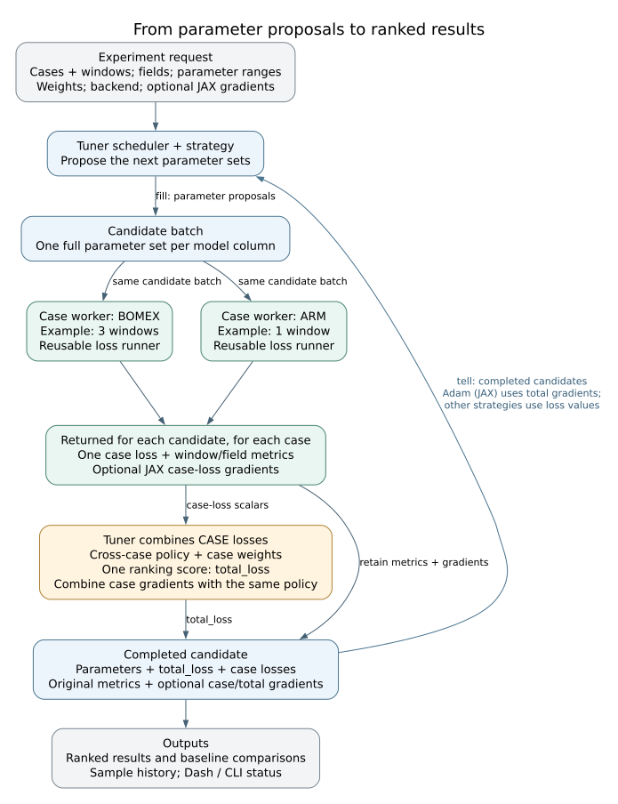
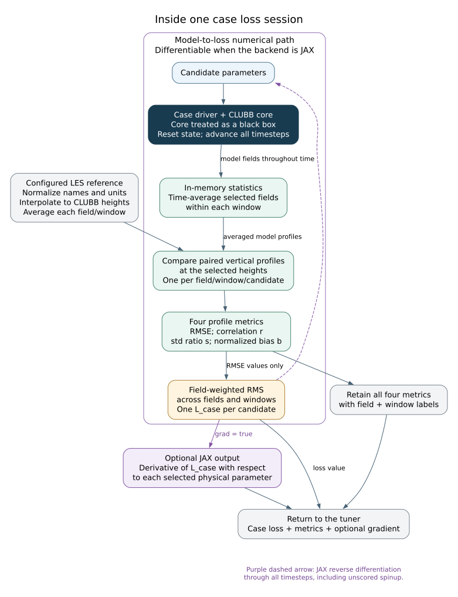

# CLUBB tuner: from model runs to parameter updates

The tuner proposes parameter sets, runs selected cases, compares time-averaged
CLUBB profiles with LES reference profiles, and ranks the results. [CLUBB core](../src/CLUBB_core/)
supplies the fields; the loss drivers and Python tuner supply the comparison,
aggregation, scheduling and result history.

The diagrams distinguish **the case loss calculated by the loss driver** from
**the cross-case score used by the tuner**. CLUBB core is treated as a black box.

## Quick start

From the repository root, evaluate eight C8 candidates with the JAX backend:

```bash
python run_scripts/run_tuner_job.py -jax -cases bomex \
  -fields wp2 -param_ranges C8:0.2:0.8 \
  -strategy random:8 -batch_size 4 -workers 1 -run_top never
```

The [tuner CLI](../run_scripts/run_tuner_job.py) prepares its managed Python/JAX
runtime and launches the job. A Fortran build is unnecessary for JAX.
Omit `-jax` to use the Fortran loss API through F2PY; that backend requires a
Python-enabled [Fortran build](../compile.py) (`python compile.py -python`).
[Dash's Tune tab](../dash_app/tune_tab/tab.py)
creates the same kind of request and uses the same scheduler and workers.

## 1. The tuning loop



An **experiment request** fixes the following before evaluating candidates:

| Input | What it controls |
| --- | --- |
| Cases and model configuration | Initial conditions, forcing, physics options and untuned parameter defaults. |
| Fields and height range | Which vertical profiles enter the comparison. Fields are shared across cases; each case can have its own height range. |
| Time range and windows, per case | Which part of each simulation is scored and how it is split into equal averaging windows. |
| Parameter ranges and strategy | Which parameters can change, their bounds, and how candidates are proposed. Linked targets can share one sampled coordinate. |
| Contribution weights and field weights | How mean, amplitude and pattern errors form a profile loss, then how fields contribute to a case loss. |
| Case weights and cross-case policy | How case losses form the final ranking score. |
| Backend and gradient controls | Fortran or JAX; whether to request JAX gradients and which differentiation mode to use. |

The [scheduler](tuning_scheduler.py) sends the **same candidate parameter sets
to every requested case**. All of a candidate's case results must arrive before
it can receive its final score. The [strategy interface](tuning_strategy.py)
proposes candidates with `fill()` and receives completed candidates with `tell()`.

`batch_size` is the number of candidate model columns evaluated together;
`max_workers` (`-workers` in the CLI) limits concurrent candidate-case evaluations.
A column represents a parameter set, not a case or an averaging window.
Cases have separate initial conditions, reference profiles and loss sessions.
Initialization and baseline setup start one worker per case, so the number of
resident worker processes can exceed the candidate-evaluation limit.

The [case worker](tuning_worker.py) retains a
[`clubb_loss_runner`](../utilities/clubb_loss_runner.py) session across batches.
Initialization prepares the case and benchmark once; each evaluation resets
the model to its initial state. JAX kernels can be reused when parameter values
change. A different grid, physics flags, stats layout or batch width can require
compilation. Persistence reuses setup and compiled work; it does not continue
one candidate's trajectory into the next candidate.

### Where the reference data enters

[`case_defaults.json`](case_defaults.json) owns each case's LES file and default
comparison ranges. The shared
[loss-namelist builder](../input/scripts/create_case_namelist.py) uses the
[benchmark converter](../input/scripts/benchmark_converter.py) to normalize LES
names and units. The loss driver reads that file, interpolates the reference
profiles onto the relevant CLUBB grid and prepares their averaging windows.
The tuner does not implement its own LES comparison math.

Model statistics used for tuning stay in memory: model-output NetCDF is not
needed for losses or JAX gradients. The LES reference still comes from a
NetCDF input file.

## 2. Inside one case: trajectory, windows and losses



The [JAX loss driver](../clubb_jax/src/clubb_loss_driver.py) and
[Fortran loss driver](../src/clubb_loss_driver.F90) own this per-case calculation.
The case driver handles initialization, forcing, timestep advancement,
radiation and microphysics around CLUBB core. Statistics collect the requested
fields during the scoring windows.

For example, `bomex:10800:21600:3600` means:

| Part of the trajectory | Treatment |
| --- | --- |
| Case initialization through 10,800 s | Advance normally; this spinup affects later fields but is not scored. |
| 10,800–14,400 s | Average model and reference profiles for window 1. |
| 14,400–18,000 s | Continue the same trajectory; average window 2. |
| 18,000–21,600 s | Continue the same trajectory; average window 3. |

Times are absolute model seconds. Each field produces one mean vertical profile
per window and candidate. **The driver compares averaged profiles; it does not
average instantaneous RMSE values.** Windows are contiguous equal subintervals,
not separate model restarts. Sampling/window boundaries must align with the
case's timestep and radiation schedule. An explicit `num_time_windows` in a
saved request chooses the count instead of an averaging interval.

### What the four profile metrics mean

Let `m` and `o` be the model and LES profiles **after time averaging**, restricted
to the compared height levels. Means and standard deviations here are across
those levels, not across time. The implementation uses population moments and
equal weighting of the compared levels.

| Returned metric | Definition for a nonflat reference | Ideal match | Interpretation |
| --- | --- | --- | --- |
| `bias_norm` (`b`) | `(mean(m) - mean(o)) / std(o)` | 0 | Signed mean offset; positive means the model profile is larger on average. |
| `std_ratio` (`s`) | `std(m) / std(o)` | 1 | Vertical variability/amplitude; below 1 is too weak, above 1 too strong. |
| `correlation` (`r`) | Correlation of the centered profiles | 1 | Similarity of vertical shape after removing means and overall amplitudes. |
| `rmse` | Weighted normalized total profile error, below | 0 | Combines the three error contributions into the profile score. |

The Taylor-style decomposition in the
[shared profile-comparison kernel](../utilities/loss_metrics.py) is:

```math
\mathrm{rmse}^2
= w_{\mathrm{mean}} b^2
+ w_{\mathrm{std}}(s-1)^2
+ w_{\mathrm{corr}}\,2s(1-r).
```

These are **mean error**, **amplitude error** and **pattern error**. The three
contribution weights are fixed, finite and strictly positive. They default to
one; then `rmse` is ordinary profile RMSE divided by the reference standard
deviation. Changing the weights changes `rmse`; the raw `r`, `s` and `b`
diagnostics keep their definitions. A Taylor diagram's centered distance omits
the mean-bias term; our total error includes it.

A flat reference uses normalization scale one and has undefined correlation
and std ratio. A flat model against a varying reference has std ratio zero but
undefined correlation. The objective uses actual moments, so it remains
computable without fake diagnostic values. Undefined diagnostics use numeric
NaN (JSON `null`); unavailable diagnostic derivatives are marked the same way.
The std-ratio derivative at a flat model is also unavailable despite its valid
value of zero.
Exactly zero norms use the loss kernel's zero-derivative convention.

### From profile scores to one case loss

For each candidate, the loss driver combines profile `rmse` values by a
field-weighted root mean square (RMS) over fields and windows:

```math
L_c = \sqrt{
\frac{\sum_f a_f \sum_{w=1}^{W_c}\mathrm{rmse}_{c,w,f}^{\,2}}
     {W_c\sum_f a_f}}.
```

Here `c` is a case, `f` a field, `w` a window, `W_c` that case's window count,
and `a_f` the fixed field weight. Field weights default to one; zero excludes
a field from this RMS, and at least one must be positive. Windows within a case have equal
weight. The driver returns **one `L_c` per candidate**, alongside all four
metrics for every field/window. It does not construct this scalar by separately
averaging correlation, std ratio and signed bias.

## 3. From case losses to the ranking score

The scheduler passes only the prepared case-loss scalars to the
[cross-case aggregation policy](taylor_metrics.py). It retains the original
metrics and gradients separately. For example, two fields over three BOMEX
windows give six profile comparisons; two fields over one ARM window give two.
These reduce to **one BOMEX loss and one ARM loss**, then the tuner combines
those two numbers. Extra windows do not automatically give BOMEX three times
the weight of ARM.

| `aggregation_mode` | How it combines active case losses |
| --- | --- |
| `quantile_weighted` (default) | Sort case losses best to worst, distribute them into up to four bins, and combine the case-weighted bin means. Default best-to-worst bin weights: `0.1, 0.4, 0.4, 0.1`. Empty bins are omitted and remaining bin weights renormalized. |
| `mean_max` | `0.6 × case-weighted mean + 0.4 × largest case loss`. |
| `mean_worst_quantile` | `0.7 × case-weighted mean + 0.3 × case-weighted mean of the worst quarter of cases` (at least one case). |

Case weights default to one; zero excludes a case from this score. The result
is `total_loss`: the scalar used for ranking and passed with each completed
candidate to the strategy. A one-case request retains that case's loss.
Default and optional config-plus-override baselines are evaluated separately
and scored by the same rules; they do not count toward candidate samples.

## 4. Where gradients are supported

**JAX automatic differentiation (AD) covers the model-to-case-loss path inside
its loss driver.**
This includes the full trajectory from initialization, unscored spinup,
in-memory time averages, profile comparisons and field/window reduction.
LES data, window definitions and configured weights are held constant.
Forward and reverse mode calculate derivatives of the requested outputs with
respect to the selected physical parameters.

| Caller / gradient target | Differentiated output | What comes back |
| --- | --- | --- |
| Tuner with `grad: true` (`-grad`), runner default `gradient_target="loss"` | One combined `L_c` per candidate, for the current case | One derivative per candidate and selected physical parameter. All four metric values also return without separate backward sweeps for them. |
| Gradient explorer, runner `gradient_target="metrics"` | Each of the four metrics for each field/window/candidate | Metric Jacobians for maps and tangent checks. This requires more output derivatives in reverse mode. |
| Fortran backend | Value-only evaluation | Four metrics and case losses; gradient requests are rejected. |

The [gradient explorer](../dash_app/services/gradient_matrix.py) uses the same loss runner
through the dashboard's persistent workers. It can also request actual
model/reference profiles for plotting. Ordinary tuner histories retain metrics
rather than all profile levels.

`gradient_mode="forward"` batches selected parameter directions with
Jacobian–vector products (JVPs).
`"reverse"` (backward mode) records a trajectory and applies pullbacks; the scalar
case-loss target needs one pullback for all selected parameters. Reverse mode
checkpoints each numerical timestep and replays it during backpropagation.
This trades retained intermediates for recomputation while differentiating
through the complete trajectory.

`"auto"` is a count heuristic: for the scalar case loss it selects reverse
when there is more than one selected physical parameter, otherwise forward.
For the diagnostic metric target it compares parameters with fields. It is
not a guarantee of the fastest mode; either mode can be selected explicitly.

**The tuner does not automatically differentiate its cross-case aggregation
or use JAX gradients to update parameters.** It stores per-case gradients and
includes them in `tell(completed)`. Existing strategies use loss values; the
current `adam` strategy uses simultaneous perturbation stochastic approximation
(SPSA), estimating gradients from perturbed loss values rather than JAX AD.
A future analytic-gradient strategy must combine case derivatives according to its
cross-case objective and apply the chain rule for linked or rescaled sampling
coordinates.


## 5. Outputs and where to find them

| Output | Granularity | Owner / destination |
| --- | --- | --- |
| Four profile metrics | Case × window × field × candidate | Loss driver → worker → scheduler; retained as labeled observations in sample history. |
| `loss` / `case_loss` | One scalar per case and candidate | Loss driver → scheduler; stored with the candidate. |
| `field_loss` | RMS over windows, per case/field/candidate | Shared runner; retained for per-field summaries. |
| `total_loss` | One scalar per candidate across its cases | Tuner aggregation; rankings, strategy feedback and best-result tables. |
| Optional JAX `gradient["loss"]` | Candidate × physical parameter, for one case | Runner → worker → scheduler/strategy; history stores sample × case × physical parameter. |

[`SampleHistoryWriter`](sample_history.py) saves compressed NumPy archives
(NPZ chunks) under `sample_history/`: full parameter rows, case losses, all window/field metrics
and optional case gradients. Observation labels identify the case, field and
window times; `gradient_parameters` labels derivative coordinates. Numeric
NaNs remain in history; JSON boundaries use `null`.

The scheduler's per-field summary uses window-RMS `rmse`; its other three
diagnostics come from the window with the largest profile RMSE. Complete
per-window values remain in `subwindows` and history.

The [job wrapper](job_runtime.py) and [status writers](status.py) communicate
through a job directory under `output/tuner/`:

- `request.json`: saved experiment configuration; validated by [request.py](request.py).
- `control.json`: graceful stop and controller keepalive.
- `status.json`: live progress, worker counts and a short best-results summary.
- `results.json`: retained ranked candidates, diagnostics, baselines, improvement percentages and optional case gradients.
- `sample_history/`: all completed candidates, not just the retained best rows.
- `worker.log` and `workers/`: controller log and per-worker setup/log files.

Controllers renew a keepalive lease; after 300 seconds without renewal the
scheduler requests a graceful stop. Direct job-directory runs are not leased
unless their control file enables it. Continuation checkpoints save scheduling
and strategy state; these differ from JAX reverse-mode timestep checkpoints.

## Running a multi-case gradient experiment

This example uses three BOMEX windows and one ARM window, two fields, fixed
Taylor contribution weights, and explicit reverse mode:

```bash
python run_scripts/run_tuner_job.py -jax -grad -gradient_mode reverse \
  -cases bomex:10800:21600:3600 arm:68400:72000 \
  -fields wp2 thlm -param_ranges C8:0.2:0.8 \
  -loss_weights '{"mean":2,"std":0.5,"corr":1}' \
  -strategy random:4 -batch_size 2 -workers 1 -run_top never
```

This gathers analytic case gradients; `random` still proposes candidates
randomly. Reverse is forced to exercise that path, not as a speed recommendation
for one parameter. Add `-dry_run` to prepare a job without launching it.
`-jax=gpu` selects the GPU runtime. The CLI's `-help` describes runtime, override
and output options; `-list_presets` lists [presets.json](presets.json) experiments.

Ranges use `PARAM:MIN:MAX`; `PARAM=PARAM:MIN:MAX` links equal physical targets
(for example, `C6rt=C6thl:0:4`). Current strategies are random sampling,
deterministic grid resolution (`resolve`), simulated annealing (`simann`) and
Adam with SPSA (`adam`).

The lower-level [job-directory entry point](tune_clubb.py) runs an already
prepared request. Use the Python environment prepared by the CLI; the request
selects the loss backend:

```bash
.venv-python/bin/python -m tuner.tune_clubb -job_dir output/tuner/my_prepared_job
.venv-python/bin/python -m tuner.tune_clubb -help
```

For loss evaluation without tuning, the [standalone loss CLI](../run_scripts/run_scm_loss.py)
uses the same loss definitions:

```bash
python run_scripts/run_scm_loss.py -jax -cases bomex -fields wp2
python run_scripts/run_scm_loss.py -jax -cases bomex -fields wp2,thlm \
  -multicol C8/0.2:0.8/8 -batch_size 4 -disable_stats_storage
```

For reusable programmatic calls, initialize `clubb_loss_runner`, call
`evaluate(params, grad=..., gradient_mode=..., gradient_target=...)` repeatedly,
then close it. Each row of `params` is one complete parameter set in
`runner.param_names` order. Its four `metrics` arrays have axes
`(window, field, candidate)`; `loss` has axes `(candidate,)`.
Case-loss gradients have axes `(candidate, parameter)`; explicit metric
Jacobians have axes `(window, field, candidate, parameter)`. The lower-level
tuple API returns four metric arrays followed by the case-loss vector.

<details>
<summary>Diagram sources and rendering</summary>

The editable Graphviz sources are [tuning_loop.dot](diagrams/tuning_loop.dot)
and [case_loss.dot](diagrams/case_loss.dot). Rebuild the shareable SVGs from the
repository root with Graphviz:

```bash
dot -Tsvg tuner/diagrams/tuning_loop.dot -o tuner/diagrams/tuning_loop.svg
dot -Tsvg tuner/diagrams/case_loss.dot -o tuner/diagrams/case_loss.svg
```

Solid arrows show forward information flow. The purple dashed arrow in the
case diagram shows reverse differentiation, not a second physical model run.

</details>
